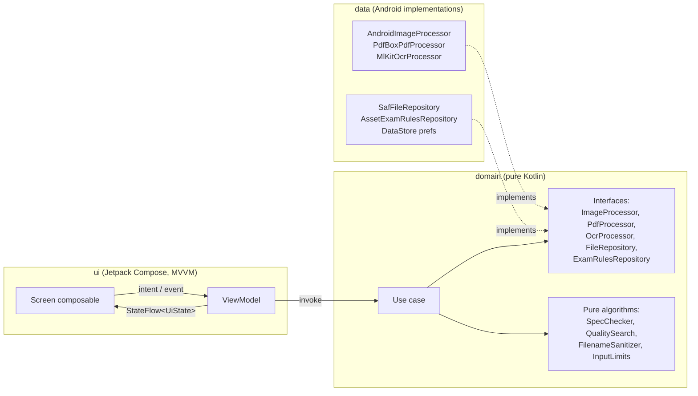
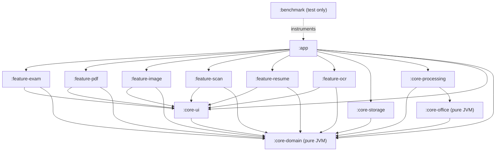
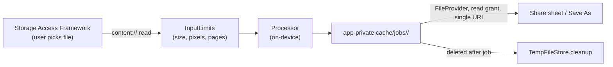

# Mr File Fixit — Architecture

Mr File Fixit is a fully offline Android app. Every byte of user content is processed on-device.
No module may use the network: the app has no ads, accounts or backend, and the build fails if any module
(including `:app`) resolves a networking library.

## 1. Layers



* **Unidirectional data flow.** Screens send events to a ViewModel. The ViewModel calls use cases and exposes one
  immutable `StateFlow<UiState>`. Screens never call use cases directly.
* **Errors are values.** Every layer returns `Result<T, AppError>`. Android/library exceptions are caught at the
  data-layer boundary (`runCatchingApp {}`) and mapped to `AppError`. `CancellationException` is always rethrown.
* **Jobs.** Each tool run is a `JobRunner` job exposing `StateFlow<JobState<T>>`
  (`Idle → Running(progress) → Success | Failed | Cancelled`).

## 2. Module graph



Rules enforced by the graph:

| Rule | How it is enforced |
| --- | --- |
| Dependencies point inward only | `core-domain` is a `kotlin("jvm")` module, so it cannot see Android or any other module. Features only see `core-ui` and `core-domain`. |
| Features never see implementations | `core-processing` and `core-storage` bind their implementations with Hilt `@Binds`. Only `:app` puts them on the classpath. |
| Nothing touches the network | The merged manifest has no `INTERNET` permission (removed in `:app`, checked in CI); `verifyNetworkIsolation` (convention plugins) fails the build if any module resolves a networking library or declares `INTERNET`; Detekt `ForbiddenImport` bans `java.net.*`, `okhttp3.*`, etc. |

## 3. Package layout per module

```
core-domain/      com.mrfilefixit.core.domain
  result/         Result, AppError, runCatchingApp
  dispatchers/    DispatcherProvider
  logging/        AppLogger (no file names/paths/content ever)
  job/            JobState, JobRunner, ProgressReporter
  file/           FileRef, OutputFile, FileRepository, TempFileStore
  security/       FilenameSanitizer, InputLimits
  image/          ImageProcessor, ImageFormat, QualitySearch, requests
  exam/           ExamProfile, DocumentSpec, SpecChecker, ExamRulesRepository, use cases
  pdf/            PdfProcessor, PdfOperation, PdfCompressionPolicy
  convert/        DocumentConverter, ConversionKind, ConvertDocumentUseCase
  document/       RichDocument, Presentation, Workbook (shared by converters, resume templates)
  resume/         Resume model (JSON drafts), 15 templates, ResumeRenderer → RichDocument, export/import use cases
  ocr/            OcrProcessor, ScriptDetector (auto-detect), OcrExporter, ExportOcrUseCase
  scan/           Import, enhance (ScanFilter, ScanFilterMath) and OCR use cases

core-office/      com.mrfilefixit.core.office       (pure Kotlin office formats, no third-party code)
  docx/ pptx/ xlsx/  OOXML readers and writers
  legacy/         Compound File reader; .doc, .ppt and .xls text readers
  pdftext/        Glyphs → lines, paragraphs, tables and slides (PDF to Word, PowerPoint, Excel)
  layout/         Workbook → printable tables
core-processing/  com.mrfilefixit.core.processing   (data layer: engines; convert/ lays documents out on PDF pages)
core-storage/     com.mrfilefixit.core.storage      (data layer: SAF, cache, FileProvider, DataStore)
core-ui/          com.mrfilefixit.core.ui           (theme, components, adaptive scaffolds, previews)
feature-*/        com.mrfilefixit.feature.<name>    (ui + feature data such as bundled exam rules)
```

## 4. Threading

* `DispatcherProvider` is injected everywhere. Decoding/encoding runs on `default`, file I/O on `io`.
* All loops call `ensureActive()` / `coroutineContext.ensureActive()` between steps, so cancelling a job stops it
  within one image or one PDF page.
* Batches above `BatchPolicy.INLINE_LIMIT` files are handed to WorkManager. The worker promotes itself to a
  foreground service (`mediaProcessing` on API 35+, `dataSync` below) only while it is running.

## 5. Privacy boundaries



## 6. Assumptions

* minSdk 26, compileSdk/targetSdk 36. HEIC decoding needs API 28+, HEIC encoding needs a device HEVC encoder,
  lossy WebP encoding uses `WEBP_LOSSY` on API 30+ and the legacy `WEBP` format below.
* PDF structure operations (merge/split/encrypt) use `pdfbox-android` (Apache-2.0). Page rendering uses the
  platform `PdfRenderer`, one page at a time.
* The ML Kit document scanner is delivered through Google Play services. Its model is downloaded once by Play
  services; scans and OCR are processed on-device. Text recognition uses the bundled Latin model and runs fully
  offline. Devanagari, Chinese, Japanese and Korean
  recognizers are bundled too, so every script works offline with no model download (see docs/OCR.md).
