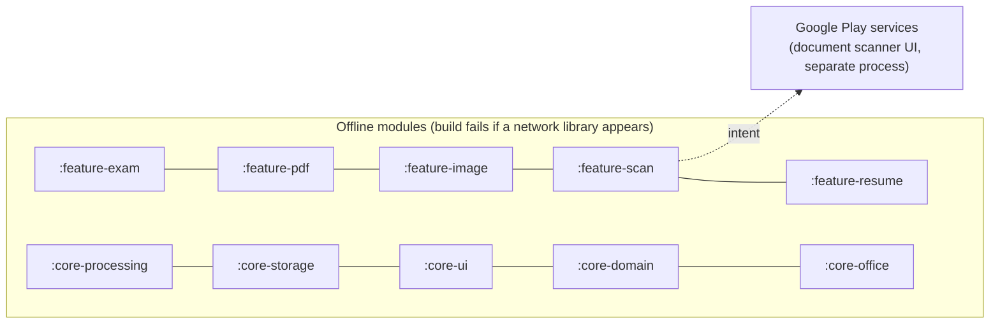

# Security and privacy

Mr File Fixit handles identity documents (photos, signatures, thumbprints, certificates). The design goal is
simple: **user files never leave the phone, and nothing about them is written anywhere the user did not choose.**

Each rule from the product spec is listed with where it is enforced and how it is checked.

| Rule | Enforced in | Checked by |
| --- | --- | --- |
| Nothing in the app touches the network (no ads, no analytics, no backend) | The app has **no `INTERNET` permission**: `app/AndroidManifest.xml` removes the one ML Kit merges in, so Android itself blocks every socket. `NetworkIsolation.kt` also fails the build if a module resolves a networking library or declares `INTERNET`; CI fails if any merged manifest (debug or release) has `INTERNET`, an ads component or `AD_ID` | `verifyNetworkIsolation` task (runs with `check`); detekt `ForbiddenImport` bans `java.net.*`, `javax.net.*`, OkHttp, Retrofit, Ktor everywhere |
| Scoped storage and SAF only; no broad storage permissions | Photo Picker / `OpenDocument` / `CreateDocument` only. `app/AndroidManifest.xml` removes `READ/WRITE/MANAGE_EXTERNAL_STORAGE` and `READ_MEDIA_IMAGES` with `tools:node="remove"` in case a library adds them | Merged-manifest review in CI (`processReleaseManifest` + grep step) |
| Validate before decoding: 50 MB, max pixels, page count | `InputLimits` (50 MB, 64 MP, 16 384 px side, 1 000 pages, 100 files). Sizes are checked from SAF metadata, then again while streaming (`LimitedInputStream`); dimensions from the header before any bitmap is allocated; page count before rendering | `InputLimitsTest`, `BatchImageUseCaseTest`, `ScanUseCasesTest` |
| Office files are untrusted input | `:core-office` parses DOCX/PPTX/XLSX with a strict XML pull parser that rejects DTDs (no XXE, no entity expansion) and reads ZIPs with entry-count, per-entry and total expanded-size caps (zip bombs); legacy DOC/PPT/XLS go through a Compound File reader with bounds and cycle checks; row, column, slide and paragraph counts are capped (`OfficeLimits`). Macros, OLE objects and external links are never executed or followed | `XmlReaderTest`, `DocxRoundTripTest`, `SheetFormatsTest` |
| Resume drafts stay private | Drafts and photos live in app-private `files/resumes/` (excluded from backup like everything else); ids are validated against `[A-Za-z0-9-]`; a photo is only copied from this app's own cache; JSON is size-capped and parsed without reflection (kotlinx-serialization) | `ResumeTest`, `ResumeViewModelTest` |
| Biodata drafts stay private | Same rules as resumes: app-private `files/biodata/`, ids and photo keys limited to `[A-Za-z0-9]`, photos copied only from this app's cache (4 MB cap), atomic writes | `BiodataModelTest`, `BiodataViewModelTest` |
| Sanitize file names | `FilenameSanitizer`: removes path separators, control and format characters (including RTL overrides), `..` runs, reserved Windows names; 100-char cap | `FilenameSanitizerTest` |
| Temp files in app-private cache; narrow share grants | Every job writes only to `cache/jobs/<uuid>/`. Output paths are canonical-checked against that root before save/share. `FileProvider` exposes `cache/jobs/` only; shares grant read on the single URI via `ClipData` | `SafFileRepository.jobFile`, `file_provider_paths.xml` |
| Temp files are cleaned up | Job dir deleted on failure/cancel, on reset, when the screen's ViewModel is cleared, and stale dirs (> 6 h) at app start. PDFBox scratch files (`*.tmp` in the cache root) left by a killed process are deleted at app start too | `JobRunnerTest` (cleanup runs on cancel) |
| Release builds do not log file names, paths or content | `AppLogger` contract; release binds a no-op Timber tree; R8 strips `android.util.Log` calls; `toString()` of `FileRef`, `OutputFile`, `DestinationUri`, `ScanCapture` and PDF password operations is redacted; `AppError.Unexpected` keeps the exception class name only, never its message | Code review + `ResultTest` |
| Crash reports exclude user data | No crash SDK is bundled. If one is added, it must use `AppError`/class names only (see "Adding a crash reporter") | — |
| Strip EXIF by default | Every re-encode drops metadata (bitmaps carry none); the lossless "Strip EXIF" path removes APP1/XMP/COM and keeps only JFIF and the ICC colour profile; PNG keeps only critical chunks plus colour chunks | `JpegSegmentsTest`, `PngChunksTest` |
| Preferences in DataStore; no keys in source | `DataStoreUserPreferences`. Optional signing secrets come from Gradle properties or CI secrets only | Code review |
| Disable backup; block cleartext | `allowBackup=false`, `data_extraction_rules.xml` and `backup_rules.xml` exclude everything; `network_security_config.xml` sets `cleartextTrafficPermitted=false` and trusts system CAs only | Manifest review |
| Never store PDF passwords | Passwords live in a `CharArray` only from the Run tap until the job ends, then are zero-filled (`PdfOperation.wipeSecrets()` in `finally`). PDFBox's API takes a `String`, so a short-lived copy exists on the heap until garbage collection; it is never kept or written. They are never in UI state that survives process death, never in `SavedStateHandle`, never logged (`toString` redacted) | `RunPdfOperationUseCaseTest` |

## Network map

## Known external components

### ML Kit telemetry (blocked)

The bundled ML Kit libraries (text recognition, selfie segmentation) depend on `com.google.android.datatransport`,
which would send usage statistics (device and app information, an installation identifier, latency, error codes;
never images, text or file names). The app removes the `INTERNET` permission that ML Kit merges in, so these
statistics can never leave the phone: the transport's upload fails and is retried later, silently. Recognition and
segmentation use bundled models and need no network. `ACCESS_NETWORK_STATE` stays: the transport scheduler and
WorkManager read connectivity with it, and on its own it cannot send anything.

The network-isolation check allow-lists `datatransport`, `firebase-encoders*`, `firebase-components` and
`firebase-annotations` by exact name, while every other `com.google.firebase` artifact still fails the build.

### Remove background

`com.google.mlkit:segmentation-selfie` ships its model inside the app, so Remove background never downloads
anything. It runs on the photo in memory and returns only a mask. Its `datatransport` telemetry is blocked as
described above.

### Document scanner

`play-services-mlkit-document-scanner` runs its UI inside Google Play services. Its model is downloaded once by
Play services; the scan itself is processed on-device and returned to the app as files in our cache. We copy
them into `cache/jobs/<id>/` (`FileRepository.importToJob`, which accepts only `content://` URIs and `file://`
URIs inside this app's own storage) and never send them anywhere.

### Ads

There are none. The ads SDK, consent SDK and advertising ID were removed; every feature is free with no limits.

### Donations

Settings → Support and the card on Home offer optional donations **in the sideloaded tester build only**. The Play
build is made with `-Pmff.donations=false` (CI's release job), which removes the Support screen, the Home card and
the Settings row, because Play's Payments policy exempts only tax-exempt charitable donations from Google Play
billing. Where the feature is on, the app itself sends nothing:

* **UPI.** The QR code is a bundled image of a fixed `upi://pay` link (payee and UPI ID only, see
  `Donation.QR_PAYLOAD`). "Pay with a UPI app" opens the user's own UPI app with an `ACTION_VIEW` intent. The
  manifest's `<queries>` entries (the `upi` scheme, plus GPay, Paytm, PhonePe and BHIM by package name) only let
  the app see which UPI apps are installed. A preset amount adds `am=` (for example `am=51.00`); "Any amount"
  leaves it out so the UPI app asks.
* **PayPal.** Opens `https://paypal.me/MrFileFixit` in the user's browser.

No payment data passes through the app, and nothing is recorded about whether anyone donated. See
[PLAY_STORE.md](PLAY_STORE.md#donations).

## Adding a crash reporter

If a crash reporter is added later, it must:

1. Be a deliberate exception to the network-isolation check (today no module is allowed network access), and
   be declared in the Play Console data-safety form.
2. Disable automatic collection of logs/breadcrumbs, or route them through `AppLogger`.
3. Never attach exception messages from the data layer; report `AppError` values and exception class names.

## Reporting a vulnerability

Please open a private security advisory on the repository rather than a public issue.
